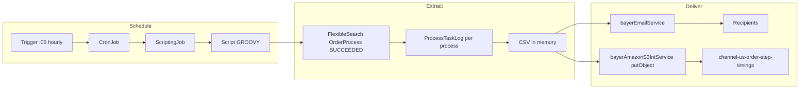

# core_cbus Order Step Timings — Hourly Report

## Process summary

Every hour, SAP Commerce (P1) runs a Groovy ScriptingJob that:

1. Looks back over a configurable window (default **1 hour**) for **SUCCEEDED** `OrderProcess` rows on store **`core_cbus`**.
2. Classifies each process as **CREATE** (`sap-order-process*`) or **MODIFY** (everything else).
3. Loads `ProcessTaskLog` rows and derives timing columns in **milliseconds**:
   - Cart submit → order conversion (`cartToOrderMs`)
   - Commerce persist → business process start
   - BP → first task / first ERP task
   - Per-step ERP API and wall times (CREATE: Steps 1–5 from `sendOrderToSAP` logs; MODIFY: prepay / OData / LCR / brand+SF)
4. Builds a CSV named `core_cbus-order-step-timings-yyyyMMdd-HHmm.csv` (UTC stamp).
5. **Emails** the CSV via `bayerEmailService` (same path as `coreUsOrderMonitorScript`).
6. **Uploads** the CSV to S3 bucket `channel-us-order-step-timings` (bucket root by default) using Vault-backed AWS credentials (`onedce.aws.path`).

Schedule: CronJob trigger `0 5 * * * ?` (minute **:05** every hour).

---

## Architecture



### Hybris types / codes

| Type | Code | Role |
|------|------|------|
| `Script` | `coreCbusOrderStepTimingsHourlyScript` | Groovy body (maintain in Backoffice / HAC; do **not** wipe via ImpEx content) |
| `ScriptingJob` | `coreCbusOrderStepTimingsHourlyJob` | `scriptURI = model://coreCbusOrderStepTimingsHourlyScript` |
| `CronJob` | `coreCbusOrderStepTimingsHourlyCronJob` | Runs the job as `admin` |
| `Trigger` | on CronJob | `0 5 * * * ?`, active |

### Source files (repo)

| File | Purpose |
|------|---------|
| `scripts/hybris/core-cbus-order-step-timings-hourly.groovy` | Full report logic (authoritative source for Script content) |
| `scripts/hybris/core-cbus-order-step-timings-hourly.impex` | Registers Script / Job / CronJob / Trigger (no Script content) |
| `scripts/hybris/core-cbus-order-step-timings-hourly.properties` | Commented property overrides for CCV2 / local |
| `scripts/export-core-cbus-order-step-timings.mjs` | Ad-hoc Node export (same CSV shape; used for 7-day one-offs) |

---

## Implementation details

### 1. Time window

```groovy
windowEnd = now
windowStart = now - HOURS_BACK hours   // default HOURS_BACK=1
```

Filter: `{OrderProcess.creationtime} >= since AND < until` and `{state}=SUCCEEDED`, store `uid = STORE`.

For a 7-day backfill, set `order.timings.report.hoursBack=168` (or run Groovy in HAC with that property / temporary override).

### 2. Process selection query

Joins `OrderProcess` → `Order` → `BaseStore`, selects:

- Process PK, code, definition name, creation/modified times  
- Order code, order creationtime, `modificationSubmitionTime`  
- Kind: `CREATE` if definition contains `sap-order-process`, else `MODIFY`  
- `sapOrderNumber`: strip `S2-` prefix from order code when present  

### 3. Task / step timing

For each process, load all `ProcessTaskLog` ordered by `startDate`.

**CREATE** (`sendOrderToSAP` log messages):

- Parse `Step N/5 [name] STARTING` / `COMPLETED|FAILED`
- Sum `time taken N ms` into `stepN_apiMs`
- Wall clock from log timestamps → `stepN_wallMs`

**MODIFY** (map task actions → synthetic steps):

| Step slot | Action |
|-----------|--------|
| 1 | `prepayFinancing` |
| 2 | `odataBatchStandard` |
| 3 | `odataBatchSplitBill` |
| 4 | `lcrDiscount` |
| 5 | `brandAndSfDiscount` |

**Cart submit time** (`cartSubmitAt`):

- Prefer `ZZ1_C2C_SAT_TECID_HDR` / `satelliteCreationTechID` ISO timestamp from ERP logs  
- Else CREATE: process creation; MODIFY: `modificationSubmitionTime`

Durations over 1 hour or negative are blanked for `msBetween` (sanity clamp).

### 4. CSV columns

Aligned with the Node exporter. Key fields:

- Identity: `orderCode`, `sapOrderNumber`, `kind`, `processCode`, `processDefinition`, `processState`
- Lead-in: `cartSubmitAt`, `orderConvertedAt`, `cartToOrderMs`
- Anchors: `orderCreated`, `modSubmitted`, `processCreated`, `processModified`
- Spans: `commercePersistToBpMs`, `bpTriggerToFirstTaskMs`, `processCreatedToFirstErpMs`, `processWallMs`
- Steps 1–5: `stepN_name`, `stepN_apiMs`, `stepN_wallMs`, `stepN_status`
- Aggregates: `erpApiMsSum`, `sendOrderToSAP_ms`, `odataBatch_ms`, `lcrDiscount_ms`, `brandAndSfDiscount_ms`, `prepayFinancing_ms`, `taskActions`

All duration fields are **milliseconds**.

### 5. Email

- Bean: `bayerEmailService.sendEmail(Email, 'core_cbus', uuid)`
- From: `onedce.general.mailbox`, else `order.timings.report.email.from`
- Subject: `Order step timings — last {N}h — {stamp} UTC` (prefixed `[NON-PROD]` when `env` ≠ `PRD`)
- Attachment: base64 CSV via `EmailAttachment`

### 6. S3 upload

- Credentials: Vault path from `onedce.aws.path` (not stored in report properties)
- Client: `bayerAmazonS3IntService.getOneDCEs3Client(region)` then `putObject`
- Default bucket: `channel-us-order-step-timings`, region `us-east-1`, **empty prefix** (object key = file name only)

Return string shape:

```text
OK rows=N file=... email=... s3=s3://bucket/key window=...
```

---

## Configuration

### Property keys

Set in CCV2 aspect properties or `local.properties`. All have Groovy fallbacks if unset.

| Property | Default | Description |
|----------|---------|-------------|
| `order.timings.report.store` | `core_cbus` | BaseStore UID filter |
| `order.timings.report.hoursBack` | `1` | Lookback hours from job start |
| `order.timings.report.email.to` | `punit.dwivedi.ext@bayer.com` | To list (`,` or `;`) |
| `order.timings.report.email.from` | `donot-reply@channelarrow.com` | Fallback From if mailbox unset |
| `order.timings.report.email.cc` | _(empty)_ | Optional CC list |
| `order.timings.report.skipEmail` | `false` | Skip email delivery |
| `order.timings.report.skipS3` | `false` | Skip S3 upload |
| `order.timings.report.s3.bucket` | `channel-us-order-step-timings` | Target bucket |
| `order.timings.report.s3.region` | `us-east-1` | AWS region |
| `order.timings.report.s3.prefix` | _(empty)_ | Optional key prefix (trailing `/` added if needed) |

### Environment prerequisites (already expected on env)

| Property / bean | Notes |
|-----------------|-------|
| `onedce.aws.path` | Vault secret path (`aws-np` on d1, `aws-prod` on p1) — fields `accessKeyId` / `secretAccessKey` |
| `vault.url` | Vault endpoint |
| `onedce.general.mailbox` | Preferred From address |
| `bayerEmailService` | Must be available on the node that runs the CronJob (background nodes need mail config) |
| `bayerAmazonS3IntService` | Vault-backed S3 client factory |

### Example overrides

```properties
order.timings.report.hoursBack=1
order.timings.report.email.to=ops@bayer.com,owner@bayer.com
order.timings.report.email.cc=team@bayer.com
order.timings.report.s3.bucket=channel-us-order-step-timings
order.timings.report.s3.region=us-east-1
order.timings.report.s3.prefix=
```

---

## How to deploy / configure

### First-time setup

1. **Create / update Script content** in HAC Scripting or Backoffice:
   - Code: `coreCbusOrderStepTimingsHourlyScript`
   - Type: `GROOVY`
   - Paste contents of `scripts/hybris/core-cbus-order-step-timings-hourly.groovy`
   - Keep **one** Script row for that code (duplicates make `model://` resolution ambiguous)

2. **Import ImpEx** (`scripts/hybris/core-cbus-order-step-timings-hourly.impex`) to create Job / CronJob / Trigger.  
   ImpEx does **not** set `Script.content` (avoids wiping the Groovy body).

3. Confirm CronJob **active**, Trigger **active**, expression `0 5 * * * ?`.

4. Optionally set properties above in the CCV2 aspect; otherwise defaults apply.

### Update script logic later

1. Edit `scripts/hybris/core-cbus-order-step-timings-hourly.groovy` in git.
2. Replace Script **content** on the env (HAC / Backoffice / Groovy update).  
   Do **not** re-import content via ImpEx `INSERT_UPDATE Script; ...; content`.
3. Re-run CronJob once or wait for the next `:05` fire.

### Manual / ad-hoc runs

- **Hourly window**: trigger CronJob `coreCbusOrderStepTimingsHourlyCronJob` or execute the Script in HAC.
- **Longer window** (e.g. 7 days): temporarily set `order.timings.report.hoursBack=168`, run once, then restore to `1`.
- **Email or S3 only**: `skipEmail=true` or `skipS3=true`.

### Verify

| Check | Where |
|-------|--------|
| Cron last/next fire | Backoffice CronJob |
| Log line `Order timings report starting` / `OK rows=` | App logs, logger `coreCbusOrderStepTimingsHourly` |
| Inbox | Subject `Order step timings — last Nh — … UTC` + CSV attachment |
| S3 object | `s3://channel-us-order-step-timings/core_cbus-order-step-timings-*.csv` |

---

## Operational notes

- **Duplicate Scripts**: multiple `Script` items with the same `code` break reliable `model://` resolution. Keep a single active row; remove extras.
- **Empty window**: `rows=0` is valid when no SUCCEEDED processes were created in the lookback; email/S3 still run with header-only CSV.
- **BG node mail**: if email fails with missing `mailSender` / JavaMail beans, ensure the CronJob runs on a node with mail configured (or use `skipEmail` and rely on S3).
- **S3 AccessDenied**: report uses dedicated bucket `channel-us-order-step-timings`; Vault IAM must allow `s3:PutObject` there.
- **Timezone**: file stamp and email window labels use **UTC**; Cron expression follows the server/node timezone for “:05”.
