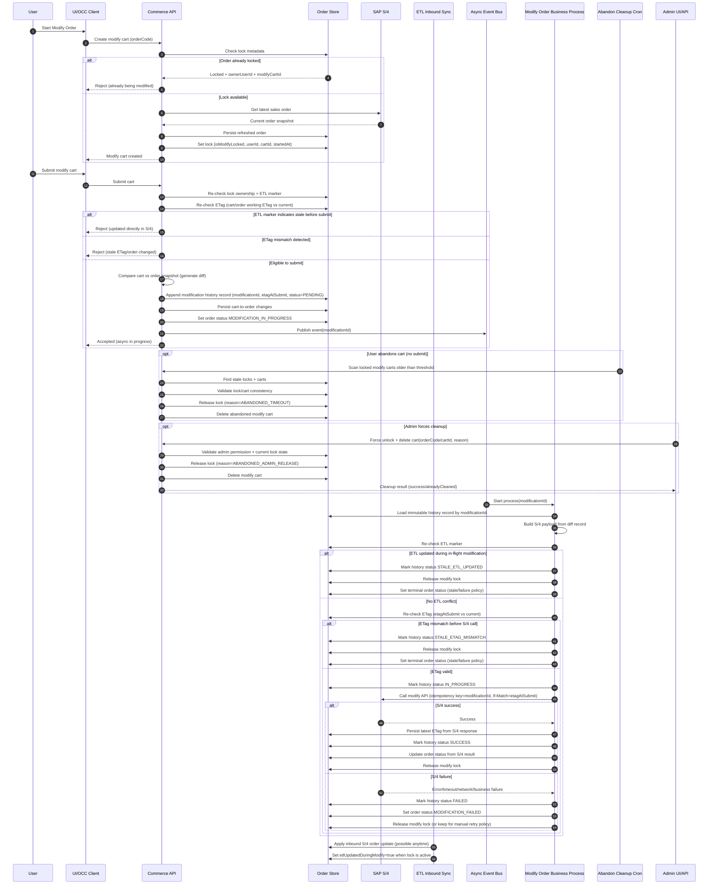

# Modify Order - Async (Enhanced Flow)

## Goal

Provide a concurrency-safe async modify-order flow that prevents overlapping edits, preserves modification history, and handles ETL/S4 race conditions.

## End-to-End Flow

1. **Create Cart from Order**
	 - Perform a backend lock check on the order.
	 - If order is already locked for modification, return an error with:
		 - lock owner user ID
		 - active modify cart ID
	 - Call S/4 Get Sales Order API.
	 - Persist S/4 response to refresh latest order data.
	 - Create modify cart from refreshed order snapshot.
	 - Set order modify lock metadata:
		 - `isModifyLocked = true`
		 - `modifyLockedByUserId`
		 - `modifyCartId`
		 - `modifyLockStartedAt`

2. **Modify Cart**
	 - Use Cart Header Update and/or Cart Entries Update APIs.

3. **Submit Cart**
	 - Re-check modification lock ownership and reject if lock belongs to another user/cart.
	 - Re-check ETag before submit:
		 - compare cart/order working ETag with latest persisted order ETag.
		 - if mismatch, reject as stale (order changed directly in S/4 or by another process).
	 - Check ETL update marker before submit:
		 - if order was updated from S/4 during modification, reject submit with stale-data error.
	 - Compare current cart vs. original order snapshot and generate diff.
	 - Persist diff as a **history record** (append-only), not a single scalar field.
		 - Include `modificationId`, `userId`, `cartId`, `createdAt`, `status`, `diffPayload`, `etagAtSubmit`.
	 - Persist cart changes to order.
	 - Emit async business process event with `modificationId`.
	 - Set order status to `MODIFICATION_IN_PROGRESS`.

## Async Business Process (Triggered After Submit)

1. Load modification record by `modificationId`.
2. Build S/4 modify payload from stored diff record.
3. Re-check ETL update marker before external call:
	 - if ETL updated order after diff creation, mark modification record as `STALE_ETL_UPDATED` and stop.
4. Re-check ETag before external call:
	 - compare `etagAtSubmit` from history record with current order ETag.
	 - if mismatch, mark history as `STALE_ETAG_MISMATCH` and stop.
5. Call S/4 modify API using If-Match header with `etagAtSubmit` (or latest validated ETag per policy).
5. On success:
	 - persist new ETag returned by S/4 response
	 - update order status from S/4 outcome
	 - mark modification record `SUCCESS`
	 - release modify lock on order
6. On failure:
	 - set order status to `MODIFICATION_FAILED`
	 - mark modification record `FAILED`
	 - release modify lock on order (or retain for manual retry, based on business policy)

## Failure Categories

- API timeout
- API/network failure
- Other HTTP errors
- S/4 business validation errors
- Stale due to ETL update while modification is in progress
- Stale due to ETag mismatch (order changed directly in S/4 or other process)
- User abandoned modify cart while order lock is still active

## ETag Mechanism in Async Flow

- Async flow must use the same ETag concurrency concept as sync flow.
- ETag capture points:
	- at cart creation (from refreshed order)
	- at submit (`etagAtSubmit` in modification history)
- ETag validation points:
	- submit-time validation before generating/persisting async work
	- async process validation before outbound S/4 modify call
- Outbound modify call should send `If-Match` ETag header.
- If S/4 returns stale/locked style error (for example `412 Precondition Failed` or mapped stale code):
	- mark modification history `STALE_ETAG_MISMATCH`
	- set terminal order status per stale policy
	- release modify lock
- On successful modify response, persist newly returned ETag for next modify cycle.

## Abandoned Modify Cart Recovery

### Scenario

A user starts modify order, acquires the order lock, and then abandons the cart (closes browser, times out, or never submits). This must not leave the order indefinitely locked.

### Option 1: Scheduled Cleanup (Cron Job)

- Introduce a scheduled cleanup job that finds active modify locks with stale carts.
- Abandonment threshold must be configurable (for example `modify.order.lock.abandon.minutes`).
- Suggested criteria for abandonment:
	- `isModifyLocked = true`
	- `modifyCartId` exists
	- cart has no update for configured threshold
	- cart has not been submitted
- Job action for each abandoned lock:
	- verify lock/cart consistency (`order.modifyCartId == cart.id`)
	- release order lock metadata
	- set lock release reason to `ABANDONED_TIMEOUT`
	- delete modify cart
	- optionally append audit event/history record
- Job should run on configurable schedule (for example every 15 minutes).
- Job should be idempotent and safe for retries.

### Option 2: Admin API Cleanup (Manual)

- Provide admin API(s) for support/admin UI to force cleanup.
- Suggested API capabilities:
	- list locked orders with lock age, user, cart, and last activity
	- force-release lock for a specific order
	- force-delete specific modify cart
	- combined operation: release lock + delete cart
- Recommended access controls:
	- admin/support role only
	- reason/comment required for forced unlock
	- full audit log (who, when, reason, order, cart)
- API behavior should be idempotent:
	- if lock/cart already cleared, return success with `alreadyCleaned=true`.

### Operational Safeguards

- Apply optimistic check before cleanup so active user edits are not interrupted accidentally.
- If cart was updated very recently (grace window), skip cleanup in cron path.
- Emit monitoring metrics:
	- locks released by cron
	- locks released by admin API
	- abandoned carts deleted
	- cleanup conflicts/skips
- Emit notification/event when forced cleanup occurs (optional, environment dependent).

## Concurrency and Data Integrity Rules

- API must enforce lock checks server-side; UI-only checks are not sufficient.
- If order is locked (`isModifyLocked = true`), do not allow another user/cart to start modify.
- Modification history must be append-only and addressable by `modificationId`.
- Async processing must read immutable history records, not a mutable single diff field.
- Event handling must be idempotent by `modificationId`.
- Retries must reuse the same `modificationId`/idempotency key.
- If ETL updates the order during modification, set ETL marker and fail in-flight modification as stale.
- Locks left by abandoned carts must be recoverable through both cron cleanup and admin API.
- Async flow must enforce ETag compare and If-Match semantics equivalent to sync flow.

## Suggested Status/Flag Model

- Order status:
	- `MODIFICATION_IN_PROGRESS`
	- `MODIFICATION_FAILED`
	- domain-specific success status from S/4
- Order lock fields:
	- `isModifyLocked`
	- `modifyLockedByUserId`
	- `modifyCartId`
	- `modifyLockStartedAt`
	- `modifyCartLastActivityAt`
	- `modifyLockReleaseReason`
	- `modifyLockReleasedAt`
	- `currentEtag`
	- `etlUpdatedDuringModify`
- Modification history record status:
	- `PENDING`
	- `IN_PROGRESS`
	- `SUCCESS`
	- `FAILED`
	- `STALE_ETL_UPDATED`
	- `STALE_ETAG_MISMATCH`
	- `ABANDONED_TIMEOUT`
	- `ABANDONED_ADMIN_RELEASE`

## Sequence Diagram

